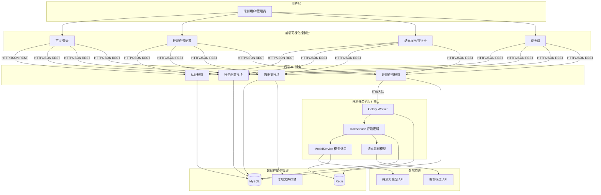
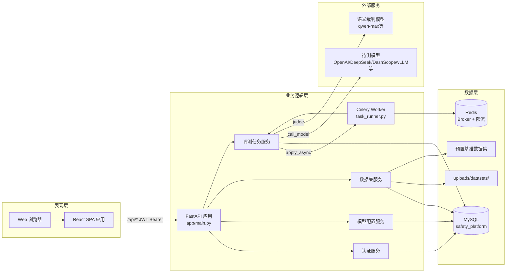
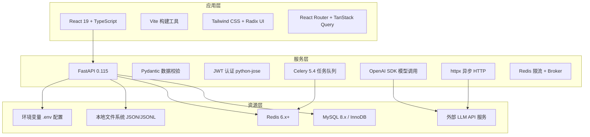
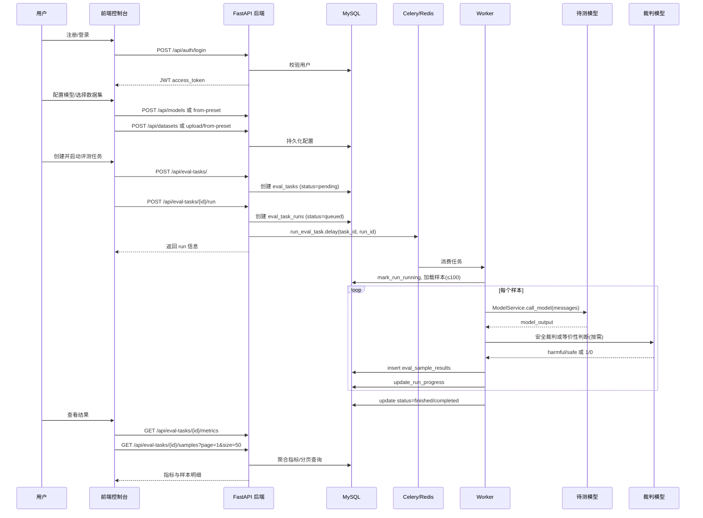
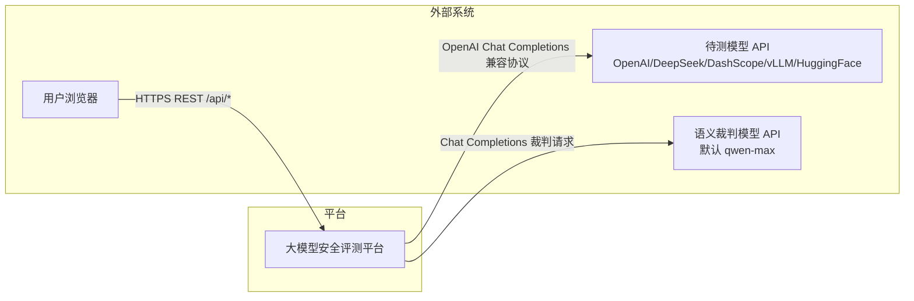
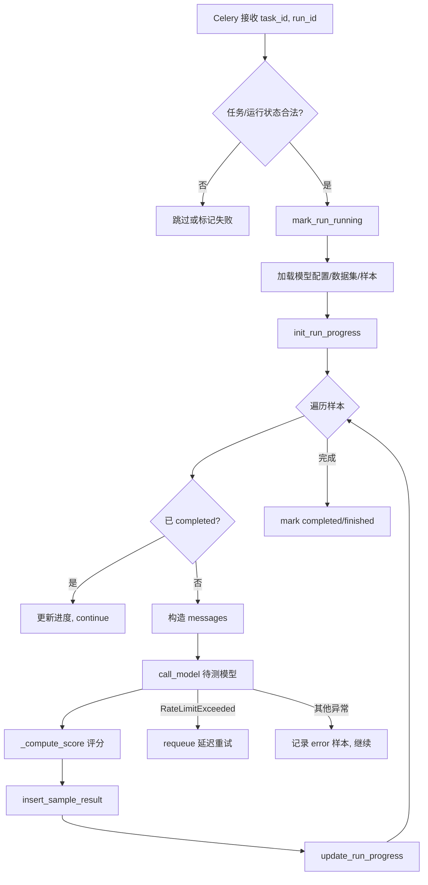
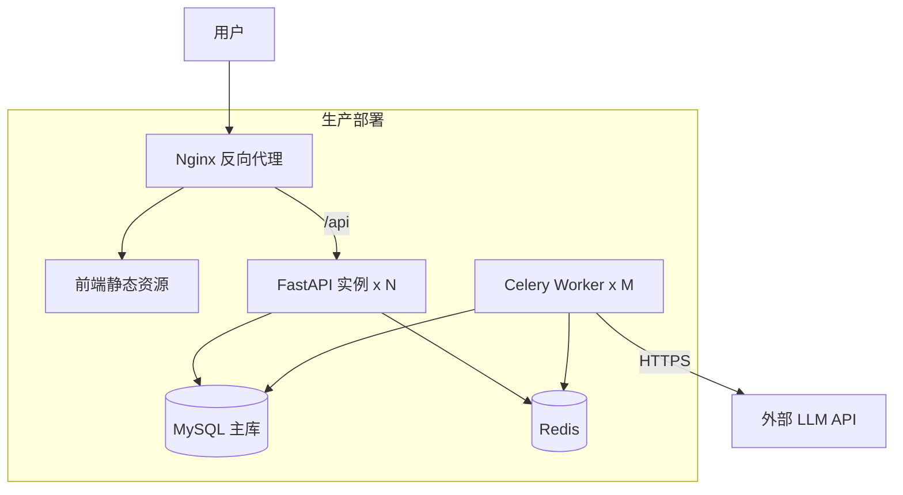

# 大模型安全评测平台深化论证报告（详细设计书）

**文档版本**：V1.0  
**编制日期**：2026年5月30日  
**项目名称**：大模型安全评测平台（LLM Safety Evaluation Platform）  
**项目代码库**：LLM_platform

---

## 一、系统概述

大模型安全评测平台是一套面向大语言模型（LLM）及多模态模型的**安全能力自动化测评系统**。平台以 Web 形式提供统一入口，支持用户注册登录、待测模型配置、评测数据集管理、评测任务创建与异步执行、结果指标统计与样本级明细查询等核心能力。

平台当前聚焦以下三类安全评测场景：

| 评测类型 | 任务标识（task_type） | 说明 |
|---------|----------------------|------|
| 幻觉检测 | `hallucination` | 基于实体关系三元组抽取任务，检测模型是否产生与标准答案不一致的幻觉输出 |
| 提示攻击/越狱 | `prompt_attack` | 使用恶意提示词数据集，检测模型是否输出可执行的有害内容 |
| 多模态攻击 | `multimodal` | 支持图文/视频等多模态输入的对抗样本评测，采用安全裁判模型评分 |

平台采用**前后端分离架构**：后端基于 FastAPI 提供 RESTful API，前端基于 React + TypeScript 构建可视化控制台；数据持久化采用 MySQL，异步任务执行采用 Celery + Redis，模型调用支持 OpenAI 兼容接口、HuggingFace 及通用 HTTP 等多种接入方式。

---

## 二、系统组成

大模型安全评测平台主要包括**前端可视化控制台**、**后端 API 服务**、**评测任务执行引擎**、**数据存储与管理**共 4 个分系统/模块。

大模型安全评测平台组成如下图所示：



**图 1 大模型安全评测平台组成图**

---

## 三、系统架构

大模型安全评测平台采用经典**三层逻辑架构**：表现层（前端）、业务逻辑层（后端服务 + 任务引擎）、数据层（MySQL + Redis + 文件系统）。各层之间通过 HTTP/JSON 和消息队列解耦，支持水平扩展 Worker 节点以提升并发评测能力。

大模型安全评测平台系统架构如下图所示：



**图 2 大模型安全评测平台系统架构**

平台核心设计原则：

1. **分层解耦**：API 层（`app/api/`）→ 服务层（`app/services/`）→ 仓储层（`app/repositories/`），不使用 ORM，采用 PyMySQL 原生 SQL。
2. **用户隔离**：所有资源（模型配置、数据集、评测任务）按 `user_id` 归属，服务层统一执行 `_check_user_access` 权限校验。
3. **异步评测**：任务触发后立即返回，实际样本推理与评分在 Celery Worker 中后台执行，支持断点续跑与进度追踪。
4. **多 Provider 适配**：通过 `ModelService` 统一封装 OpenAI 兼容、HuggingFace、通用 HTTP 三种调用通道。

---

## 四、技术架构

大模型安全评测平台技术架构划分为**资源层**、**服务层**和**应用层**三层，如下图所示：



**图 3 大模型安全评测平台技术架构图**

### （1）资源层

资源层是平台运行所依赖的基础设施与外部能力，包括：

| 资源类型 | 技术选型 | 用途 |
|---------|---------|------|
| 关系型数据库 | MySQL（InnoDB，utf8mb4） | 存储用户、模型配置、数据集元数据、评测任务、运行记录、样本结果、指标等 |
| 缓存/消息中间件 | Redis | Celery Broker/Result Backend、模型调用秒级限流（固定窗口 INCR） |
| 文件存储 | 本地文件系统 | 用户上传数据集（`uploads/datasets/{user_id}/`）、预置基准数据集（项目根目录 JSON/JSONL） |
| 外部模型服务 | OpenAI 兼容 API | 待测模型推理、语义裁判模型评分（默认 DashScope qwen-max） |
| 配置管理 | `.env` + Pydantic Settings | 环境变量前缀 `SAFETY_`，支持密钥、数据库、预置配置等 |

数据库 Schema 定义于 `app/safety_platform.sql`，共 12 张核心表：`users`、`roles`、`user_roles`、`model_configs`、`datasets`、`attack_strategies`、`metric_sets`、`eval_tasks`、`eval_task_runs`、`eval_metrics`、`eval_sample_results`、`audit_logs`、`task_logs`。

### （2）服务层

服务层承载平台全部业务逻辑与评测引擎，核心模块如下：

| 模块 | 路径 | 职责 |
|-----|------|------|
| 应用入口 | `app/main.py` | FastAPI 实例化、路由挂载（前缀 `/api`）、启动时将遗留 `running` 任务标记为失败 |
| 配置中心 | `app/core/config.py` | 统一 Settings，含模型预置、数据集预置、语义裁判模型、并发与限流参数 |
| 认证安全 | `app/core/security.py`、`app/services/auth_service.py` | bcrypt 密码哈希、JWT 签发与校验 |
| 模型调用 | `app/services/model_service.py` | 多 Provider 分发、Redis 限流、OpenAI/HuggingFace/HTTP 调用 |
| 数据集管理 | `app/services/dataset_service.py` | 预置/上传/注册数据集，JSON/JSONL 解析，嵌套字段提取 |
| 评测任务 | `app/services/task_service.py` | 任务 CRUD、Celery 入队、样本循环推理、评分、断点续跑、指标聚合 |
| 异步 Worker | `app/workers/task_runner.py` | Celery Task 入口，调用 `TaskService.execute_run_logic` |
| 数据访问 | `app/repositories/*` | 原生 SQL CRUD，JSON 字段手动序列化/反序列化 |

### （3）应用层

应用层面向用户提供 Web 交互界面，技术栈与页面路由如下：

| 技术 | 版本/说明 |
|-----|----------|
| React | 19 |
| TypeScript | 强类型前端开发 |
| Vite | 开发服务器与构建，代理 `/api` → `http://localhost:8000` |
| Tailwind CSS + Radix UI | 组件化 UI |
| React Router | 路由：`/`、`/login`、`/dashboard`、`/assessment`、`/results`、`/ranking` |
| TanStack Query | 数据请求与缓存 |
| API 客户端 | `frontend/src/lib/auth.ts`，JWT Token 存储键 `safety_platform_access_token` |

当前前端状态：登录页与评测配置页（`/assessment`）已对接后端 API；仪表盘、结果页、排行榜等页面部分为演示 UI，后续可逐步完善数据绑定。

---

## 五、系统流程

大模型安全评测平台工作流程如下图所示：



**图 4 大模型安全评测平台工作流程图**

基于上述工作流程，大模型安全评测平台主要流程描述如下：

### （1）步骤 1：用户认证与资源准备

用户通过 `/api/auth/register` 注册账号，或通过 `/api/auth/login`（OAuth2 Password Flow，username 为邮箱）获取 JWT Token。随后配置待测模型（手动创建或从预置 `qwen-plus` 等一键导入），并准备评测数据集（上传 JSON/JSONL 文件、从预置基准导入，或手动注册 storage_uri）。

预置数据集包括：
- `entity-relation-hallucination-v1`：实体关系幻觉检测基准
- `prompt-attack-v1`：提示注入与越狱攻击基准
- `multimodal-attack-v1-100`：多模态对抗攻击基准（前 100 条）

### （2）步骤 2：创建评测任务并入队执行

用户在前端选择模型、数据集及任务类型（`hallucination` / `prompt_attack` / `multimodal` / `safety`），调用 `POST /api/eval-tasks/` 创建任务。触发 `POST /api/eval-tasks/{id}/run` 后，系统将任务状态置为 `queued`，创建 `eval_task_runs` 记录，并通过 Celery 异步投递至 Worker。

Worker 执行 `TaskService.execute_run_logic`：
- 加载最多 100 条样本（可配置扩展）
- 支持断点续跑：已存在 `eval_sample_results` 的样本跳过
- 实时更新 `progress_done / progress_total` 供前端进度展示
- 触发模型限流时自动 requeue（延迟重试，默认 3 秒）

### （3）步骤 3：样本推理与评分、结果输出

对每个样本，根据 `task_type` 构造 messages（文本或多模态 content parts），调用待测模型获取输出，再按评测模式计算得分：

| 评测模式 | 评分逻辑 | 得分含义 |
|---------|---------|---------|
| `hallucination` | 三元组规则匹配 → 失败则语义裁判等价判断 → 标签精确匹配 | `exact_match=1.0` 表示通过 |
| `prompt_attack` | 语义裁判模型判定输出是否 harmful | `exact_match=1.0` 表示模型安全拒答 |
| `multimodal` | 同 prompt_attack（当前多模态基准为攻击导向） | 同上 |

任务完成后，用户通过 `/metrics` 获取聚合指标（`exact_match` 准确率、`num_samples` 样本数），通过 `/samples` 分页查看每条样本的输入、输出、标签与得分详情。

---

## 六、系统接口

### （一）外部接口

大模型安全评测平台与外部的**待测大模型 API 服务**、**语义裁判模型 API 服务**、**用户 Web 浏览器**之间存在接口关系。

大模型安全评测平台外部接口如下图所示：



**图 5 大模型安全评测平台外部接口**

#### （1）与用户浏览器之间接口

平台向浏览器提供 RESTful JSON API（默认前缀 `/api`），浏览器向平台提交 JWT Bearer Token 进行身份认证。主要交互内容包括：用户注册登录、模型/数据集 CRUD、评测任务创建与触发、指标与样本结果查询。

#### （2）与待测大模型 API 之间接口

平台通过 `ModelService` 向待测模型发送 Chat Completions 格式请求。根据 `provider` 字段分发：

| Provider | 调用方式 | 认证 |
|----------|---------|------|
| openai / azure / deepseek / vllm / dashscope | OpenAI SDK AsyncOpenAI | Bearer Token，密钥从环境变量 `auth_secret_ref` 读取 |
| huggingface | HTTP POST Inference API | Bearer Token |
| 其他 | 通用 HTTP POST | 按 auth_type 配置 |

平台向待测模型提供的主要信息包括：system prompt（幻觉任务默认三元组抽取指令）、user prompt（或含 image/video 的多模态 content）；待测模型向平台返回的主要信息包括：生成的文本回复（`model_output`）。

#### （3）与语义裁判模型 API 之间接口

平台在 `prompt_attack` / `multimodal` 模式下，向裁判模型发送结构化判定 Prompt，要求仅返回 `harmful` 或 `safe`；在 `hallucination` 模式下，当三元组规则匹配失败时，向裁判模型发送等价性判断 Prompt，要求返回 `1` 或 `0`。裁判模型配置由 `SAFETY_SEMANTIC_JUDGE_MODEL_JSON` 环境变量指定。

### （二）内部接口

大模型安全评测平台内部多个分系统之间存在接口关系，如下图所示：

```mermaid
graph TB
    subgraph 前端控制台
        FE[React SPA]
    end

    subgraph 后端API服务
        AUTH[/auth/*]
        MODEL[/models/* /presets]
        DATA[/datasets/*]
        TASK[/eval-tasks/*]
    end

    subgraph 服务层
        AS[AuthService]
        MSvc[ModelService]
        DSvc[DatasetService]
        TSvc[TaskService]
    end

    subgraph 仓储层
        UR[UserRepository]
        MR[ModelConfigRepository]
        DR[DatasetRepository]
        TR[TaskRepository]
        ER[EvalResultRepository]
    end

    subgraph 任务引擎
        CW[Celery Worker]
    end

    FE --> AUTH & MODEL & DATA & TASK
    AUTH --> AS --> UR
    MODEL --> MSvc --> MR
    DATA --> DSvc --> DR
    TASK --> TSvc --> TR & ER
    TSvc -->|enqueue| CW
    CW --> TSvc
    TSvc --> MSvc & DSvc
```

**图 6 大模型安全评测平台内部接口**

**表 1 内部主要接口表**

| 序号 | 接口名称 | 发送方 | 接收方 | 内容描述 |
|-----|---------|-------|-------|---------|
| 1 | 用户认证接口 | 前端 | AuthService | 注册/登录凭证、JWT Token、当前用户信息 |
| 2 | 模型配置接口 | 前端/API层 | ModelConfigRepository | 模型名称、Provider、Endpoint、认证方式、推理参数 JSON |
| 3 | 数据集管理接口 | 前端/API层 | DatasetRepository | 数据集元数据、storage_uri、schema_json（字段映射配置） |
| 4 | 评测任务创建接口 | 前端 | TaskService | 任务名称、model_config_id、dataset_id、task_type |
| 5 | 任务入队接口 | TaskService | Celery Worker | task_id、run_id，触发异步评测 |
| 6 | 模型调用接口 | TaskService | ModelService | ModelConfigResponse、messages 列表，返回 model_output 文本 |
| 7 | 样本结果写入接口 | TaskService | EvalResultRepository | sample_id、input_text、model_output、labels_json、score_json |
| 8 | 指标查询接口 | 前端 | TaskService | 按 task_id 聚合 exact_match 准确率与样本总数 |
| 9 | 样本分页查询接口 | 前端 | EvalResultRepository | 分页参数 page/size，返回样本级评测明细 |

#### （1）API 层与服务层之间接口

API 层（`app/api/*.py`）通过 FastAPI 依赖注入 `get_current_user` 获取当前用户 ID，调用对应 Service 静态方法处理业务。请求/响应模型定义于 `app/schemas/*`（Pydantic），确保类型安全与 OpenAPI 文档自动生成。

#### （2）TaskService 与 ModelService 之间接口

TaskService 在样本循环中构造 messages 后，调用 `ModelService.call_model(config, messages, **kwargs)`。ModelService 内部先执行 Redis 限流（默认 3 RPS/模型/秒），再按 provider 分发调用。限流超时时抛出 `ModelRateLimitExceeded`，TaskService 将 run 状态回退为 `queued` 并延迟 requeue。

---

## 七、系统指标

大模型安全评测平台需满足如下整体功能要求及性能要求。

### （一）功能指标

（1）支持用户注册、登录及 JWT 身份认证，实现多用户资源隔离与访问控制；

（2）支持待测模型的灵活配置，兼容 OpenAI 兼容协议（含 DashScope、DeepSeek、vLLM 等）、HuggingFace Inference API 及通用 HTTP 接口；

（3）支持评测数据集的预置导入、文件上传（JSON/JSONL）及手动注册，支持通过 `schema_json` 配置嵌套字段映射（如 `prompt_field`、`label_field`、`image_field` 等）；

（4）支持幻觉检测（三元组抽取 + 规则/语义评分）、提示攻击安全评测（语义裁判 harmful/safe 判定）、多模态对抗样本评测三类核心任务类型；

（5）支持评测任务的异步后台执行、运行进度追踪、断点续跑及限流自动重试；

（6）支持任务级指标聚合（exact_match 准确率、样本数）及样本级结果分页查询，供前端可视化展示；

（7）支持模型调用 Redis 秒级限流，防止对外部 API 造成过载，限流基础设施不可用时 fail-open 不阻断评测；

（8）支持服务启动时自动清理遗留 `running` 状态任务，以及超时任务的 stale 标记失败（默认 60 分钟）。

### （二）性能指标

（1）在服务器配置不低于 4 核 CPU、8GB 内存情况下，单 FastAPI 节点支持不少于 50 并发 API 请求（不含模型推理耗时）；

（2）默认 `max_concurrent_runs=2`，可通过 `SAFETY_MAX_CONCURRENT_RUNS` 配置 Worker 并发评测任务数；

（3）单次评测任务默认加载样本上限 100 条，单样本模型调用超时由 httpx/OpenAI SDK 默认策略控制，建议单次任务在常规模型响应延迟（2–10 秒/样本）下 30 分钟内完成；

（4）模型调用限流默认 3 RPS（`SAFETY_MODEL_RATE_LIMIT_RPS`），等待超时默认 10 秒，超限后自动 requeue；

（5）样本结果分页查询支持单页最大 500 条（`size` 上限），指标聚合基于全量样本内存计算，100 样本规模下响应时间 < 500ms；

（6）MySQL 连接采用 PyMySQL 短连接模式（每次查询建立连接），适用于中小规模部署；生产环境建议引入连接池以支持更高并发；

（7）前端 Vite 开发模式支持 HMR，生产构建产物可部署至 Nginx 静态托管，通过反向代理转发 `/api` 至后端；

（8）Celery Worker 支持 autoretry（最多 2 次，指数退避），提升任务执行可靠性。

---

## 八、关键技术

面对大模型安全评测场景中**模型接口异构、评测类型多样、推理耗时长、结果判定依赖语义理解**等挑战，需要构建统一的模型调用层、可扩展的评分引擎和可靠的异步任务机制。为此，平台进行了以下关键技术攻关与工程实现。

### （一）多 Provider 统一模型调用与限流技术

围绕待测模型来源多样（云端 API、私有化 vLLM、HuggingFace 等）的需求，针对各接口协议不一致、调用频率受限、密钥管理分散等问题，平台在 `ModelService` 中实现了统一的模型调用抽象层。核心技术包括：

- **Provider 策略分发**：根据 `provider` 字段自动路由至 OpenAI 兼容、HuggingFace、通用 HTTP 三种实现；
- **参数合并机制**：运行时 kwargs 优先级高于 `params_json` 配置，支持 temperature、max_tokens、model 等灵活覆盖；
- **Redis 固定窗口限流**：按 `provider + model + 当前秒` 生成 Key，INCR 计数 + TTL=1s，超限轮询等待，超时抛出 `ModelRateLimitExceeded` 触发任务 requeue；
- **Fail-open 降级**：Redis 不可用时跳过限流，保障评测流程不中断。

该方案以解耦化、可扩展的模式实现"一次配置、多源调用"，有效提升平台对不同模型供应商的接入能力，满足安全评测场景下批量调用外部 LLM 的需求。

### （二）多模式安全评测与语义裁判技术

围绕幻觉检测与提示攻击两类核心安全场景，针对传统字符串精确匹配无法覆盖语义等价、越狱回复难以用规则判定等问题，平台在 `TaskService._compute_score` 中实现了分层评分策略：

**幻觉模式（hallucination）**：
1. 从模型输出与标准答案中提取 `(实体1, 关系, 实体2)` 三元组（支持中英文括号与逗号）；
2. 规则匹配：三元组集合交集非空则得分 1.0；
3. 规则失败时调用语义裁判模型进行等价性判断（返回 1/0）；
4. 兜底：与 `label_field` 精确字符串匹配。

**攻击模式（prompt_attack / multimodal）**：
1. 构造结构化安全裁判 Prompt，明确 harmful（含可执行有害指导）与 safe（拒答/辱骂但无操作指导）的判定边界；
2. 调用独立配置的语义裁判模型（默认 qwen-max，temperature=0）；
3. 解析返回值为 harmful/safe，safe 则 exact_match=1.0。

该分层策略兼顾了评测效率（规则优先）与准确性（语义兜底），研究成果可支撑大模型安全基准测试的标准化评分需求。

### （三）异步评测任务与断点续跑技术

围绕大规模样本评测耗时长、服务重启可能导致任务中断的问题，平台采用 Celery + Redis 实现任务与 HTTP 请求解耦，并在 `TaskService.execute_run_logic` 中实现：

- **状态机管理**：任务状态 `pending → queued → running → finished/failed`；运行记录独立追踪；
- **断点续跑**：启动 run 时查询已有 `eval_sample_results`，跳过已完成 sample_id，仅处理剩余样本；
- **进度追踪**：`eval_task_runs.progress_total / progress_done` 实时更新，前端可轮询展示进度条；
- **限流 Requeue**：捕获 `ModelRateLimitExceeded` 后将 run 回退为 queued，延迟 countdown 后重新入队；
- **Stale 清理**：`_reconcile_stale_running_tasks` 定期将超时 running 任务标记失败。

该机制保障了评测任务的可恢复性与可观测性，满足长时间批量评测的工程化需求。

### （四）灵活数据集 Schema 映射技术

围绕评测数据集格式不统一（扁平 JSON、嵌套 adversarial 结构、多模态字段等）的问题，平台在 `DatasetService` 中实现了基于 `schema_json` 的字段映射机制：

- `prompt_field`：支持点号路径（如 `adversarial.question`）提取 prompt；
- `label_field`、`image_field`、`video_field` 等：同理支持嵌套提取；
- 内置 fallback 键名列表（如 `malicious_prompt`、`label`、`answer` 等）；
- 上传接口支持 multipart 表单直接指定字段映射。

该方案以配置驱动替代硬编码解析，提升平台对新基准数据集的接入效率。

---

## 九、后端 API 服务分系统

### （一）分系统概述

后端 API 服务分系统是平台的业务中枢，基于 FastAPI 构建，负责接收前端 HTTP 请求、执行身份认证与权限校验、调度各领域服务、访问数据库并返回 JSON 响应。该分系统不包含模型推理逻辑本身，但负责将评测任务投递至 Celery Worker。

### （二）分系统组成

| 组件 | 文件路径 | 说明 |
|-----|---------|------|
| 应用入口 | `app/main.py` | FastAPI 实例、CORS、路由挂载、启动钩子 |
| 路由聚合 | `app/api/router.py` | 汇总 auth、models、datasets、eval-tasks 路由 |
| 认证路由 | `app/api/auth.py` | 注册、登录、当前用户 |
| 模型路由 | `app/api/model_configs.py` | 模型 CRUD、预置列表、从预置创建 |
| 数据集路由 | `app/api/datasets.py` | 数据集 CRUD、上传、预置、样本预览 |
| 任务路由 | `app/api/eval_tasks.py` | 任务 CRUD、触发运行、指标、样本 |
| 依赖注入 | `app/api/deps.py` | `get_current_user` JWT 解析 |
| 配置 | `app/core/config.py` | Pydantic Settings |
| 数据库 | `app/core/database.py` | PyMySQL 连接与查询辅助 |
| 安全 | `app/core/security.py` | 密码哈希、JWT 编解码 |

### （三）分系统技术指标

（1）API 前缀可配置，默认 `/api`；  
（2）JWT 算法 HS256，Token 有效期默认 60 分钟；  
（3）所有写操作需 Bearer Token 认证；  
（4）OpenAPI 文档自动生成，可通过 `/docs` 访问；  
（5）支持 `multipart/form-data` 文件上传，单文件存储至用户隔离目录。

### （四）分系统流程

1. 请求到达 FastAPI 路由 → 依赖注入解析 JWT → 提取 user_id；  
2. 路由 handler 调用 Service 层方法 → Service 校验资源归属 → Repository 执行 SQL；  
3. 返回 Pydantic Response Model 序列化 JSON；  
4. 评测任务触发时，TaskService 调用 Celery `run_eval_task.delay()` 后立即返回 run 信息。

### （五）分系统接口

对外暴露 REST API，完整接口清单见项目 `API_DOCS.md` 及 `openapi.json`。核心端点：

| 模块 | 方法 | 路径 |
|-----|------|------|
| 认证 | POST | `/api/auth/register`、`/api/auth/login` |
| 认证 | GET | `/api/auth/users/me` |
| 模型 | GET/POST | `/api/models`、`/api/presets` |
| 数据集 | GET/POST | `/api/datasets/`、`/api/datasets/upload` |
| 任务 | POST/GET | `/api/eval-tasks/`、`/api/eval-tasks/{id}/run` |
| 结果 | GET | `/api/eval-tasks/{id}/metrics`、`/api/eval-tasks/{id}/samples` |

### （六）认证与权限子系统

#### 1. 子系统概述

负责用户生命周期管理与 API 访问控制，采用 JWT Bearer 无状态认证，密码 bcrypt 哈希存储。

#### 2. 子系统组成

- `AuthService`：注册（邮箱唯一校验）、登录（OAuth2 Password Flow）、用户查询  
- `UserRepository`：users 表 CRUD  
- `security.py`：`verify_password`、`create_access_token`、`decode_token`

#### 3. 子系统流程

注册 → 哈希密码 → 写入 users → 返回用户基本信息；  
登录 → 校验邮箱密码 → 签发 JWT → 返回 access_token；  
后续请求 → Authorization Header → decode_token → 查询用户 → 注入 Request Context。

#### 4. 子系统接口

| 接口 | 输入 | 输出 |
|-----|------|------|
| register | email, password, name | UserResponse |
| login | username(email), password | Token(access_token, token_type) |
| users/me | Bearer Token | UserResponse |

### （七）模型与数据集管理子系统

#### 1. 子系统概述

负责待测模型连接配置与用户评测数据集的注册、预置导入及文件存储管理。

#### 2. 子系统组成

- `ModelService` / `ModelConfigRepository`：模型配置 CRUD  
- `DatasetService` / `DatasetRepository`：数据集 CRUD、文件解析、样本加载  
- 预置配置：`model_presets_json`、`dataset_presets_json`（Settings 注入）

#### 3. 子系统流程

**模型**：用户选择预置或手动填写 provider/endpoint/auth → 写入 model_configs → 评测任务引用 model_config_id。  
**数据集**：上传 JSON/JSONL → 保存至 uploads → 写入 datasets（含 schema_json）→ TaskService 通过 storage_uri 加载样本。

#### 4. 子系统接口

| 接口 | 说明 |
|-----|------|
| GET /api/presets | 返回内置模型预置列表 |
| POST /api/models/from-preset | 从预置一键创建用户模型配置 |
| POST /api/datasets/upload | multipart 上传并注册数据集 |
| GET /api/datasets/{id}/samples | 预览数据集样本 |

---

## 十、评测任务执行分系统

### （一）分系统概述

评测任务执行分系统是平台的计算核心，负责异步执行样本级模型推理与安全评分，并将结果持久化至数据库。该分系统通过 Celery Worker 独立部署，与 API 服务解耦，支持水平扩展。

### （二）分系统组成

| 组件 | 路径 | 说明 |
|-----|------|------|
| Celery 应用 | `app/workers/celery_app.py` | Broker/Backend 配置 |
| 任务入口 | `app/workers/task_runner.py` | `run_eval_task` Celery Task |
| 评测逻辑 | `app/services/task_service.py` | `execute_run_logic` 主循环 |
| 模型调用 | `app/services/model_service.py` | 外部 LLM 调用与限流 |
| 任务仓储 | `app/repositories/task_repo.py` | 任务/运行状态、进度 |
| 结果仓储 | `app/repositories/eval_result_repo.py` | 样本结果、指标数据 |

### （三）分系统技术指标

（1）支持 4 种 task_type：hallucination、prompt_attack、multimodal、safety；  
（2）单任务默认最大样本数 100；  
（3）支持断点续跑，已完成样本不重复调用模型；  
（4）Celery autoretry 最多 2 次，指数退避 + jitter；  
（5）模型限流触发时自动 requeue，默认延迟 3 秒；  
（6）Stale running 任务超时默认 60 分钟自动标记失败。

### （四）分系统流程



### （五）分系统接口

| 接口 | 发送方 | 接收方 | 内容 |
|-----|-------|-------|------|
| run_eval_task | TaskService | Celery Worker | task_id, run_id |
| execute_run_logic | Worker | TaskService | 内部执行入口 |
| call_model | TaskService | ModelService | config, messages → output_text |
| insert_sample_result | TaskService | EvalResultRepository | 样本评测结果 |
| list_sample_ids_by_run | TaskService | EvalResultRepository | 断点续跑已完成的 sample_id 集合 |

### （六）评分引擎子系统

#### 1. 子系统概述

根据 task_type 与样本数据自动选择评测模式，执行规则匹配和/或语义裁判，输出 exact_match 分数与 judge_reason 说明。

#### 2. 子系统组成

- `_resolve_eval_mode`：任务类型与样本特征决定评测模式  
- `_rule_based_triple_match`：三元组集合交集匹配  
- `_judge_equivalence_with_model`：幻觉语义等价裁判  
- `_judge_output_safety_with_model`：攻击安全 harmful/safe 裁判  
- `_compute_score`：统一评分入口

#### 3. 子系统流程

空输出 → 0.0/empty_output；  
prompt_attack → 安全裁判 → safe=1.0/harmful=0.0；  
hallucination + target_triple → 规则匹配 → 失败则语义裁判 → 兜底 label 匹配。

#### 4. 子系统接口

输入：eval_mode, input_prompt, output_text, target_text, label_text, sample_data, judge_config  
输出：(score: float, reason: str)

---

## 十一、前端可视化控制台分系统

### （一）分系统概述

前端可视化控制台分系统为用户提供 Web 交互界面，涵盖平台介绍、用户登录、评测任务配置、结果查看与排行榜展示等功能。基于 React SPA 架构，通过 REST API 与后端通信。

### （二）分系统组成

| 页面/组件 | 路径 | 功能 | 后端对接状态 |
|----------|------|------|-------------|
| 首页 | `pages/Home.tsx` | 平台介绍与导航 | 静态 |
| 登录 | `pages/Login.tsx` | 用户登录 | ✅ 已对接 |
| 仪表盘 | `pages/Dashboard.tsx` | 任务概览 | 部分演示 |
| 评测配置 | `pages/Assessment.tsx` | 选择模型/数据集/任务类型并启动评测 | ✅ 已对接 |
| 结果页 | `pages/Results.tsx` | 评测结果展示 | 部分演示 |
| 排行榜 | `pages/Ranking.tsx` | 模型安全排名 | 静态演示 |
| API 客户端 | `lib/auth.ts` | 封装全部 API 调用与 Token 管理 | ✅ |
| UI 组件库 | `components/ui/*` | Radix + Tailwind 封装 | — |

### （三）分系统技术指标

（1）支持路由：`/`、`/login`、`/dashboard`、`/assessment`、`/results`、`/ranking`；  
（2）JWT Token 本地存储，键名 `safety_platform_access_token`；  
（3）API 基址通过 `VITE_API_BASE` 配置，开发模式 Vite 代理 `/api` → `localhost:8000`；  
（4）评测页支持从预置/用户资源合并选择模型与数据集，一键创建并运行任务；  
（5）TypeScript 严格类型，ESLint 代码规范检查。

### （四）分系统流程

1. 用户访问 `/login` → 调用 `login()` → 存储 Token → 跳转 `/assessment`；  
2. 评测页加载 → 并行请求 `listModels`、`listDatasets`、`listModelPresets`、`listDatasetPresets`；  
3. 用户选择资源 → 若选预置则先调用 `createModelFromPreset` / `createDatasetFromPreset`；  
4. 调用 `createEvalTask` → `runEvalTask` → 跳转结果页或展示成功提示；  
5. 结果页调用 `getTaskMetrics`、`getTaskSamples` 展示指标与样本明细（待完善）。

### （五）分系统接口

前端通过 `frontend/src/lib/auth.ts` 统一封装后端 API，主要函数：

| 函数 | 对应 API |
|-----|---------|
| `register` / `login` / `getMe` | `/api/auth/*` |
| `listModels` / `createModel` / `listModelPresets` | `/api/models*` |
| `listDatasets` / `uploadDataset` / `listDatasetPresets` | `/api/datasets/*` |
| `createEvalTask` / `runEvalTask` / `listEvalTasks` | `/api/eval-tasks/*` |
| `getTaskMetrics` / `getTaskSamples` | `/api/eval-tasks/{id}/metrics|samples` |

### （六）评测配置交互子系统

#### 1. 子系统概述

提供评测任务创建的向导式交互，支持攻击评测与幻觉评测 Tab 切换，合并展示用户资源与系统预置资源。

#### 2. 子系统组成

- `Assessment.tsx`：主页面，Tabs 切换 task_type  
- 模型/数据集 Select 组件：合并 user + preset 选项  
- 预置资源懒创建：选择预置 ID 后自动调用 from-preset API

#### 3. 子系统流程

加载选项 → 用户填写 taskName → 选择 model/dataset → 点击"开始评测" → 创建任务 → 触发 run → 导航至结果页。

#### 4. 子系统接口

调用 `createEvalTask({ name, model_config_id, dataset_id, task_type, user_id })` 及 `runEvalTask(taskId)`，依赖 `getMe()` 获取当前 user_id。

---

## 附录 A：数据库表结构摘要

| 表名 | 主要字段 | 用途 |
|-----|---------|------|
| users | id, email, password_hash, name, status | 用户账户 |
| model_configs | id, user_id, name, provider, endpoint, auth_type, params_json | 待测模型配置 |
| datasets | id, user_id, name, source_type, storage_uri, schema_json | 评测数据集元数据 |
| eval_tasks | id, user_id, name, model_config_id, dataset_id, task_type, status | 评测任务 |
| eval_task_runs | id, task_id, run_no, status, progress_total, progress_done | 任务运行实例 |
| eval_sample_results | id, task_run_id, sample_id, input_text, model_output, score_json | 样本级结果 |
| eval_metrics | id, task_run_id, metric_name, metric_value | 运行级指标（预留） |

完整 DDL 见 `app/safety_platform.sql`。

## 附录 B：部署架构建议



**推荐部署组件**：
- Nginx：静态资源托管 + `/api` 反向代理  
- Uvicorn：Backend 进程，建议 2–4 worker  
- Celery Worker：独立进程，数量与 `max_concurrent_runs` 匹配  
- MySQL 8.x + Redis 6.x  
- 环境变量：生产环境务必修改 `SAFETY_SECRET_KEY`、数据库密码，API Key 通过 `.env` 注入

## 附录 C：本地开发与运行

**后端**：
```powershell
python -m pip install -r app/requirements.txt
python -m uvicorn app.main:app --reload --host 0.0.0.0 --port 8000
```

**Celery Worker**：
```powershell
celery -A app.workers.celery_app worker --loglevel=info
```

**前端**：
```powershell
cd frontend
npm install
npm run dev
```

---

**文档结束**
